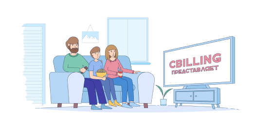

## interface simple et intuitive pour l'enregistrement d'une émission TV avec IPTV (diffusion en direct):

Télécharger puis exécuter le fichier iptv_recorder.hta, idéalement: 
- placer [ ce fichier ](https://github.com/pounichka59/iptv-live-auto-recording-hta/raw/refs/heads/main/iptv_recorder.hta?download=1) dans un sous repertoire au choix, par exemple sur C:\PRG\IPTV_RECORDER\
- créer un raccourcis du fichier et coller le raccourcis sur votre bureau Windows puis double cliquer

Ce script vous permet d'enregistrer vos émissions TV favorites en qualité d'image impeccable  avec un fichier de sortie MP4 relativement léger (optimisation parfaite, moins de 700Mo /H possible). 

- conçu pour un pack TV de Cbilling (https://cbilling.eu)
- nécessite VLC installé sur l'ordinateur.
- fichier de sortie MP4, à copier ensuite sur une clef USB à destination du port USB sur lecteur BlueRay de salon.
- Durée d'enregistrement modifiable en parametre à l'écran
- possibilité de programmer un début d'enregistrement, à désactiver ou réactiver à volonté selon vos besoins.

  
objectif d'utilisation et avantages: 
- enregistrer une emission TV
- programmer un enregistrement automatique
- interface simple et intuitive
- Fichier de sortie optimisé avec une qualité d'image parfaite
- aucun réglage technique, tout est automatique...  (codec, nombre d'images par secondes, définition d'image, etc...).

projet d'évolution du script: 
- modifier le nom de fichier et son emplacement (par exemple pour générer le fichier de sortie directement sur clef USB)
- systeme de calendrier de sélection du jour pour la programmation
- ajouter / supprimer un programme
- pilotage à distance: pour ajouter un programme d'enregistrement et l'activer
- Gestion des abonnements IPTV et des chaines (autres que Cbilling)
- autres évolutions...

  Vous pouvez modifier ce script dont je suis l'auteur pour l'adapter selon vos besoins, sa conception permet de traiter généralement n'immorte quelle liste de lecture IPTV (pas uniquement Cbilling)

Revendeur de pack TV Cbilling, vous pouvez me contacter pour tout abonnement. Je fournis également des terminaux à raccorder directement sur votre téléviseur, proposant un affichage direct en plein écran des chaines TV de votre abonnement (immédiatement au démarrage, sans passer par un menu, comme avec un lecteurs multimédia classique) , puis offrant la possibilité de zapper par telecommande avec touches numerotées (utilisation simple et fonctionnelle comme sur un tunner TV classique). Il ne suffit que de brancher, allumer, utiliser.

Pour vos besoins multimedia je propose aussi à la vente des routeurs pré-équipés VPN pour diffuser en WIFI ainsi que par cable réseau (cable ethernet) une connection sécurisée sous VPN, ce maérériel convient pour le streamming et visionnage TV, ne contient pas de systeme android embarqué (donc fonctionnement stable et constant, absence de nécessité de mise à jour, ni aucun changement dans la durée). 

Sylvain DANGEL / PrestAzur.fr

---
